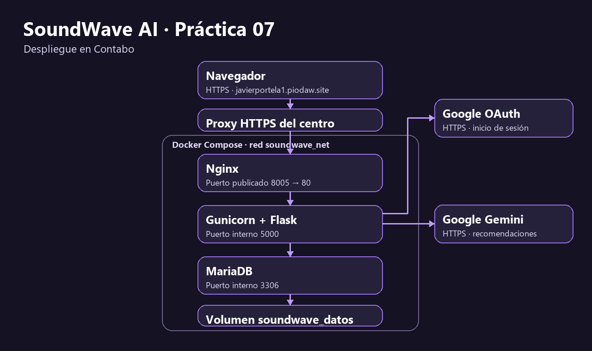

# SoundWave AI · Práctica 07

Aplicación musical con Flask, Gunicorn, MariaDB y Nginx. Permite explorar el catálogo,
guardar favoritos, gestionar playlists propias y pedir recomendaciones a Gemini.



## Ejecutar en Windows

Desde `practica07-produccion`, conserva el `.env` existente. Para una
instalación nueva, parte de `.env.example` y rellena sus valores en privado.
Registra en Google Cloud los dos retornos OAuth autorizados.

- `http://localhost:8005/auth/callback`
- `https://javierportela1.piodaw.site/auth/callback`

```powershell
docker compose config -q
docker compose up -d --build
docker compose ps
```

Abre [SoundWave AI en local](http://localhost:8005). Al iniciar Flask, la
migración inserta 40 canciones que falten y crea la tabla de cuotas. Se ejecuta
también en volúmenes existentes, preservando los IDs y las filas previas.
Las nuevas canciones usan ilustraciones locales por género y búsquedas de Spotify
por título y artista. El catálogo base queda en 50 canciones.

## SoundWave DJ

Añade `GEMINI_API_KEY` al `.env` privado para activar las consultas. La ruta
`/dj` permite ver la página sin sesión y requiere Google y CSRF para recomendar.
El backend envía la consulta y el catálogo a Gemini, comprueba los IDs devueltos
y muestra las canciones y enlaces guardados en MariaDB. La cuota por día UTC es
de 5 consultas por cuenta y 40 globales. Las llamadas fallidas también consumen
cuota local si la solicitud llegó a reservarla.

## VPS compartido de Contabo

Destino existente: `/opt/alumnos/javierportela1/practica07-produccion`.
El proxy del centro termina TLS para `javierportela1.piodaw.site` y reenvía
al puerto **8005**. Solo Nginx publica un puerto. Flask y MariaDB se conectan
por la red interna y MariaDB conserva el volumen `soundwave_datos`.

1. Por SSH, verifica el directorio y guarda una copia privada de los archivos de
   código que vayas a actualizar. Si existe una base con datos del usuario,
   conserva también un volcado privado con el procedimiento autorizado del centro.
2. Transfiere los archivos de la actualización a un directorio temporal de tu
   cuenta por SCP. Verifica sus sumas SHA-256. Aplica los archivos individualmente
   en el destino, conservando el `.env`, backups y capturas existentes. Si el
   destino está vacío, transfiere el árbol de aplicación, Compose, Nginx y SQL
   del proyecto completo y configura el `.env` en el servidor.
3. En el destino, ejecuta `docker compose config -q` para validar la configuración
   sin imprimir las variables. Consulta `docker compose ps` para ver el estado.
4. Espera el cron del profesor a las 08:00, 14:00 o 20:00, según el horario del
   centro. En el VPS compartido, **se reserva el arranque, parada y reinicio
   al cron del profesor**. Si la versión sigue antigua, comprueba con él si
   el cron reconstruye Flask y vuelve a cargar Nginx.
5. Comprueba Inicio, Explorar, Google OAuth, favoritos, CRUD de playlists y DJ
   en HTTPS. Revisa que `/api/canciones` incluya el catálogo ampliado.

Si hay una incidencia en el VPS, recupera los archivos modificados de la copia
privada antes de la siguiente ejecución del cron. Conserva el volumen.
El código anterior puede convivir con las nuevas canciones y la tabla de cuotas.

## Evidencias de la práctica 07

| Archivo | Evidencia |
| --- | --- |
| `capturas/01-ssh-contabo.png` | Sesión SSH abierta con `whoami` y `hostname`. |
| `capturas/02-directorio-vps.png` | Salida de `pwd` y listado de archivos del proyecto. |
| `capturas/03-transferencia-scp.png` | Transferencia y verificación de archivos, sin mostrar secretos. |
| `capturas/04-docker-compose.png` | `docker compose ps` después de la ejecución del cron. |
| `capturas/05-https-inicio.png` | Inicio con el dominio HTTPS visible. |
| `capturas/06-https-dj.png` | DJ con una recomendación de Gemini en el dominio HTTPS. |

El material de la práctica 05 se conserva a continuación como referencia histórica.

<details>
<summary>README histórico de la práctica 05</summary>

# Práctica 05: Docker Compose y MariaDB

## 1. Descripción del proyecto

Esta práctica consiste en desplegar una aplicación web Flask conectada a una base de datos MariaDB mediante Docker Compose, utilizando Nginx como proxy inverso.

También se comprueba la persistencia de los datos y se realizan operaciones de copia de seguridad y restauración.

## 2. Tecnologías utilizadas

- **AWS EC2:** servidor Ubuntu donde se despliega el proyecto.
- **Docker:** ejecución de aplicaciones mediante contenedores.
- **Docker Compose:** gestión de los tres servicios.
- **Flask:** aplicación web desarrollada en Python.
- **Gunicorn:** servidor de aplicaciones Python.
- **MariaDB:** almacenamiento de las tareas.
- **Nginx:** proxy inverso que recibe las peticiones HTTP.

## 3. Arquitectura

El proyecto utiliza tres contenedores:

1. **Nginx:** recibe las peticiones del navegador por el puerto 8080 del servidor y las reenvía a Flask.
2. **Flask:** consulta las tareas almacenadas en MariaDB y genera una tabla HTML.
3. **MariaDB:** almacena los datos en un volumen persistente de Docker.

Los servicios se comunican mediante una red interna de Docker Compose.

## 4. Estructura del proyecto

- `app/`: aplicación Flask, dependencias y Dockerfile.
- `nginx/`: configuración del proxy inverso.
- `database/`: scripts SQL para crear la tabla e insertar los datos iniciales.
- `backups/`: copia de seguridad `backup.sql`.
- `capturas/`: evidencias del desarrollo de la práctica.
- `docs/`: diagrama de arquitectura.
- `docker-compose.yml`: definición de los servicios, red y volumen.

## 5. Despliegue en AWS EC2

El proyecto se comprimió en un archivo ZIP y se transfirió a la instancia EC2 mediante SCP.

Después se descomprimió en `/opt/practica05`.

Para construir y arrancar los servicios se ejecutó:

`sudo docker compose up -d --build`

Para comprobar el estado de los contenedores:

`sudo docker compose ps`

Se verificó que MariaDB estaba en estado `healthy` y que Flask y Nginx estaban funcionando.

## 6. Acceso a la aplicación

La aplicación se publicó mediante Nginx en el puerto **8080**, para evitar conflictos con el servidor Nginx instalado en la práctica anterior.

Dirección utilizada:

`http://44.208.21.231:8080`

Se configuró una regla de entrada en el grupo de seguridad de AWS para permitir el acceso al puerto 8080.

La aplicación muestra las tareas almacenadas en la base de datos.

## 7. Persistencia de datos

MariaDB utiliza el volumen de Docker `datos_mariadb`, que permite conservar la información incluso al eliminar y volver a crear los contenedores.

Para comprobarlo, se insertó una tarea adicional llamada **Prueba de persistencia**.

Después se detuvieron los contenedores mediante:

`sudo docker compose down`

Y se volvieron a iniciar:

`sudo docker compose up -d`

Al consultar nuevamente la base de datos, se comprobó que las **6 tareas** seguían almacenadas.

## 8. Copia de seguridad

Se generó un archivo `backup.sql` utilizando `mariadb-dump`.

Esta copia contiene la estructura y los datos de la base de datos `practica05javier`.

El archivo se guardó en la carpeta `backups/` y también se descargó al ordenador local.

## 9. Simulación de pérdida y restauración

Para simular una pérdida de información, se eliminaron los registros de la tabla `tareas`.

Después se restauró la base de datos utilizando el archivo `backup.sql`.

Finalmente, se realizó una consulta SQL y se comprobó que las **6 tareas** habían sido recuperadas correctamente.

## 10. Conclusiones

La práctica permite comprobar cómo Docker Compose facilita el despliegue de una aplicación formada por varios servicios.

Se ha verificado que:

- Nginx puede actuar como proxy inverso de Flask.
- Flask puede consultar datos de MariaDB.
- Los volúmenes permiten mantener los datos entre reinicios.
- Las copias de seguridad permiten recuperar la información ante una pérdida de datos.

En un entorno de producción sería recomendable proteger las contraseñas mediante secretos o variables de entorno gestionadas de forma segura y configurar HTTPS con un certificado válido.
</details>
